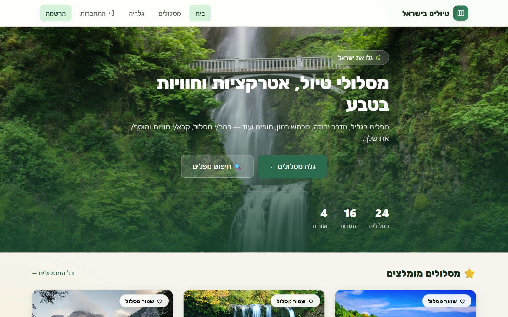
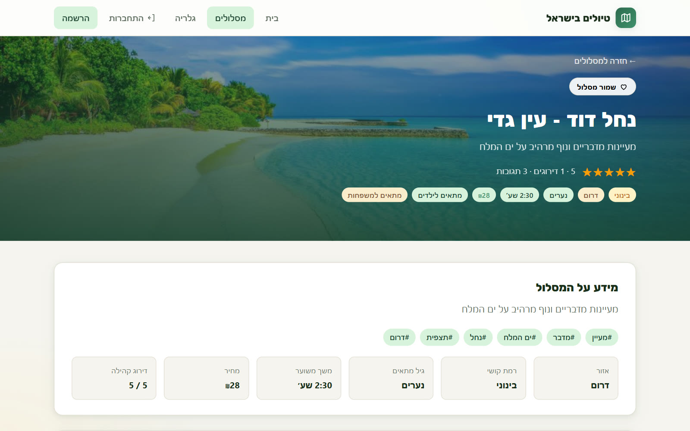
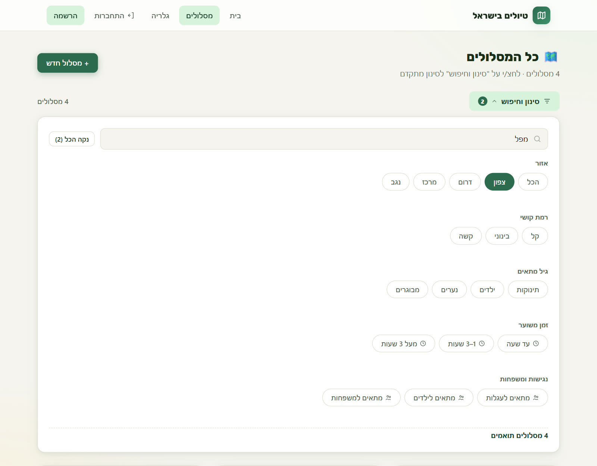
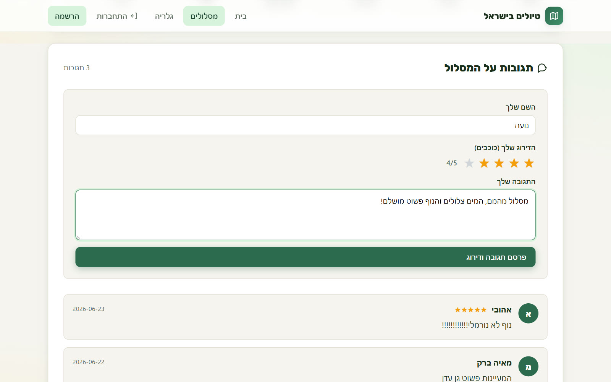
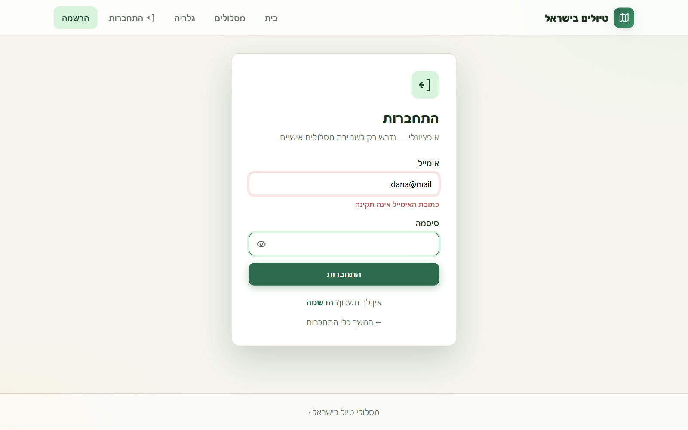
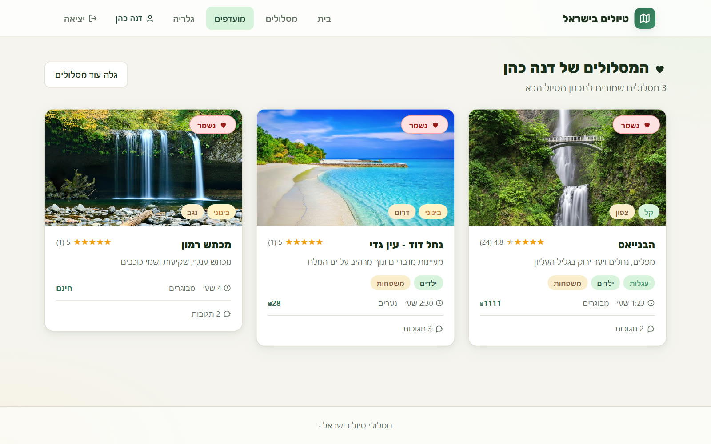
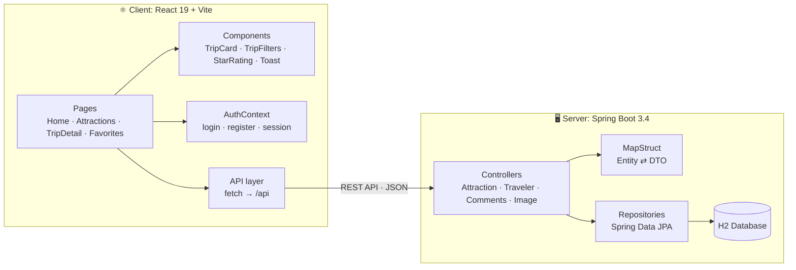

<h1 align="center">🌿 Attractions · מסלולי טיול בישראל</h1>

<p align="center">
  <b>אפליקציית Full Stack לגילוי, סינון, דירוג ושמירה של מסלולי טיול בישראל: מוצאים מסלול שמתאים בדיוק לכם, קוראים חוויות של מטיילים ומשאירים דירוג משלכם.</b>
</p>

<h3 align="center">🎬 סרטון הדגמה (2:19, עם קריינות)</h3>

https://github.com/user-attachments/assets/207a01d7-45e0-4e70-a0e1-e327c2a6ec49

---

## 🧩 המערכת: שני חלקים שעובדים יחד

| חלק | תפקיד | תיקייה |
|------|--------|--------|
| 💻 **צד לקוח** | React: דף בית, סינון, דף מסלול, תגובות, מועדפים, התחברות | [`AttractionProject/client`](AttractionProject/client) |
| ⚙️ **שרת API** | Spring Boot · REST API · JPA · מסד נתונים H2 | [`AttractionProject/server`](AttractionProject/server) |

---

## ✨ מה רואים במערכת

<table>
<tr>
<td width="50%" align="center"><br><b>🏠 דף בית חי</b><br>תמונות מתחלפות · נתונים חיים מהשרת · מסלולים מומלצים לפי ממוצע הדירוגים</td>
<td width="50%" align="center"><br><b>📍 דף מסלול</b><br>רמת קושי · אזור · משך · מחיר · נגישות · תגיות שמובילות למסלולים דומים</td>
</tr>
<tr>
<td align="center"><br><b>🔍 סינון וחיפוש מתקדם</b><br>אזור · גיל · קושי · זמן · נגישות. כל הסינון נשמר בכתובת הדף, כך שאפשר לשתף קישור</td>
<td align="center"><br><b>⭐ תגובות ודירוג כוכבים</b><br>דירוג 1–5 שנשמר בשרת, והממוצע של המסלול מתעדכן מיד</td>
</tr>
<tr>
<td align="center"><br><b>🔐 התחברות חכמה</b><br>ולידציה לאימייל · אימייל לא רשום ← מעבר אוטומטי להרשמה · הצגת סיסמה</td>
<td align="center"><br><b>❤️ מועדפים אישיים</b><br>שמירת מסלול בלחיצה · רשימה נפרדת לכל משתמש · ההרשמה אופציונלית</td>
</tr>
</table>

### 🚀 הרצה מהירה

```bash
# שרת: http://localhost:8585
cd AttractionProject/server
./mvnw spring-boot:run          # Windows: mvnw.cmd spring-boot:run

# לקוח: http://localhost:5173
cd AttractionProject/client
npm install
npm run dev
```

צריך JDK 17 ומעלה ו-Node.js 18 ומעלה. בזמן פיתוח, Vite מעביר את כל הבקשות ל-`/api` לשרת בפורט 8585.

---

## 📚 תיעוד טכני

### טכנולוגיות

| שכבה | טכנולוגיה |
|------|-----------|
| Backend | Java 17, Spring Boot 3.4.5, Spring Data JPA, H2, MapStruct, Lombok, Maven |
| Frontend | React 19, Vite 8, React Router 7, CSS מותאם (RTL מלא), Fetch API |
| Auth ומועדפים | בצד הלקוח, ב-`localStorage`, עם הפרדה לפי משתמש |

### ארכיטקטורה



- **השרת בנוי בשכבות:** Controller → Repository → Entity, עם DTO ו-MapStruct להמרה ביניהם.
- **הלקוח מודולרי:** קומפוננטות לשימוש חוזר, `AuthContext` לניהול ההתחברות, מערכת הודעות (Toast) גלובלית, ושכבת API נפרדת.
- **סינון שנשמר בכתובת הדף:** בעזרת `useSearchParams`, כך שכל תוצאת סינון היא קישור שאפשר לשתף.

### API

| משאב | נתיב בסיס | פעולות |
|------|-----------|--------|
| מסלולים | `/api/Attraction` | `getAll` · `get/{id}` · `add` · `update` · `delete/{id}` (וגרסאות DTO) |
| תגובות | `/api/Comments` | כמו למעלה, ובנוסף `byAttraction/{id}` (תגובות למסלול, מהחדשה לישנה) |
| מטיילים | `/api/travel` | CRUD מלא |
| תמונות | `/api/imageAttr` | CRUD מלא |

**דוגמה:** הוספת תגובה עם דירוג

```http
POST /api/Comments/add
Content-Type: application/json

{
  "idAttraction": { "id": 1 },
  "traveler": { "idTraveler": 1 },
  "content": "מסלול מדהים!",
  "rating": 5
}
```

**H2 Console:** http://localhost:8585/h2-console. JDBC: `jdbc:h2:./AttractionProject1`, משתמש `sa`, סיסמה `1234`

### מבנה הפרויקט

```
AttractionProject/
├── server/                     # Spring Boot: REST API
│   └── src/main/java/.../
│       ├── Controller/         # REST endpoints
│       ├── Service/            # MapStruct mapper
│       ├── Repository/         # Spring Data JPA
│       ├── model/              # JPA entities
│       ├── Dto/                # DTOs + enums (קל / בינוני / קשה ...)
│       └── config/             # CORS
└── client/                     # React + Vite
    └── src/
        ├── pages/              # Home, Attractions, TripDetail, Favorites, Login ...
        ├── components/         # TripCard, TripFilters, StarRating, Toast ...
        ├── context/            # AuthContext
        ├── api/                # שכבת קריאות לשרת
        └── utils/              # auth, favorites, ratings, filters
```

📖 תיעוד מפורט נוסף: [שרת](AttractionProject/server/README.md) · [לקוח](AttractionProject/client/README.md) · [סקירה כללית](AttractionProject/README.md)
